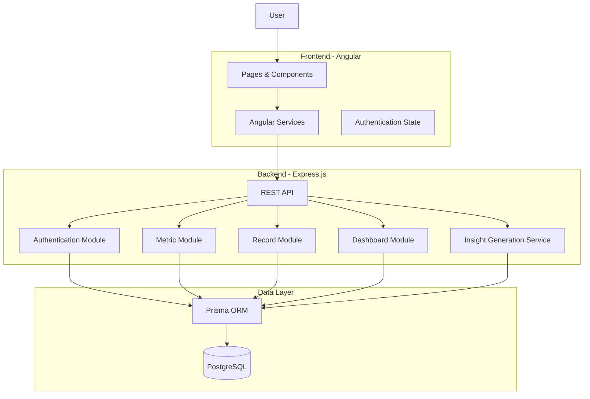
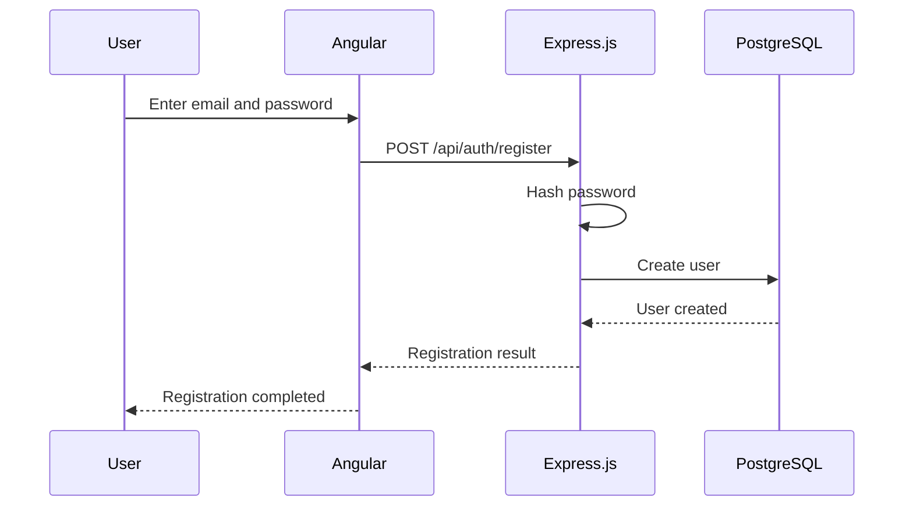
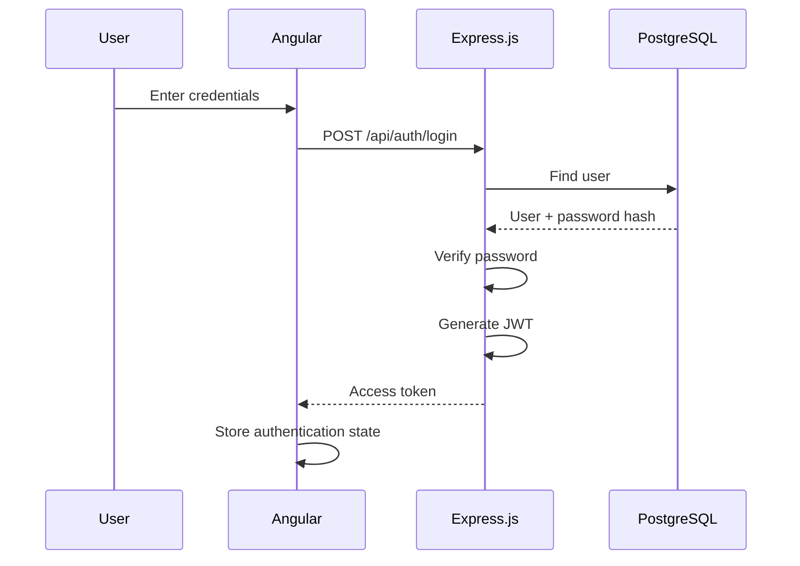
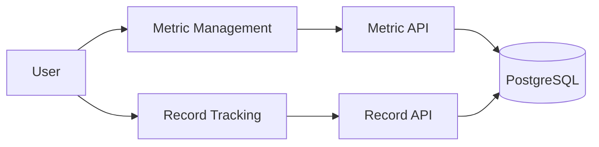
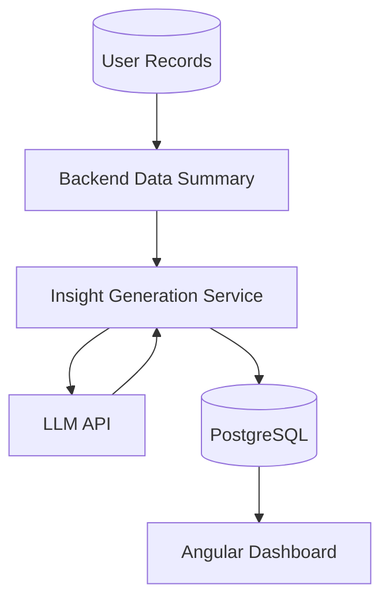

# Glance System Architecture

## 1. Purpose

เอกสารฉบับนี้กำหนดสถาปัตยกรรมของระบบ Glance เพื่อใช้เป็นแนวทางสำหรับการออกแบบและพัฒนาระบบ MVP โดยเน้นโครงสร้างที่เข้าใจง่าย พัฒนาได้รวดเร็ว และเหมาะสมกับขอบเขตของโครงงาน

Architecture นี้ออกแบบให้สามารถเริ่มต้นด้วย Mock AI สำหรับ MVP และสามารถเปลี่ยนเป็น LLM-powered Insight ในอนาคตได้โดยไม่จำเป็นต้องเปลี่ยนโครงสร้างหลักของระบบ

---

## 2. Architecture Overview

Glance ใช้สถาปัตยกรรมแบบ Layered Architecture โดยแบ่งระบบออกเป็น 3 ชั้นหลัก

```text
┌──────────────────────────────────────────┐
│           Presentation Layer             │
│                                          │
│              Angular App                 │
│      Pages / Components / Services       │
└───────────────────┬──────────────────────┘
                    │ HTTP / REST API
                    ▼
┌──────────────────────────────────────────┐
│           Application Layer              │
│                                          │
│             Express.js API               │
│   Authentication / Business Logic / AI   │
└───────────────────┬──────────────────────┘
                    │ Prisma ORM
                    ▼
┌──────────────────────────────────────────┐
│              Data Layer                  │
│                                          │
│             PostgreSQL                   │
│     Users / Profiles / Metrics /         │
│     Records / Insights                   │
└──────────────────────────────────────────┘
```

### Main Technology Stack

| Layer          | Technology             | Responsibility                             |
| -------------- | ---------------------- | ------------------------------------------ |
| Frontend       | Angular                | User interface and client-side interaction |
| Backend        | Express.js             | REST API and application logic             |
| ORM            | Prisma                 | Database access and schema management      |
| Database       | PostgreSQL             | Persistent data storage                    |
| Authentication | JWT + Password Hashing | User authentication and API authorization  |
| AI Insight     | Mock AI → LLM          | Insight generation                         |

---

## 3. System Architecture

### 3.1 High-Level Architecture



---

## 4. Frontend Architecture

The frontend is implemented using Angular.

Its responsibility is to:

- Display the user interface.
- Receive user input.
- Validate basic input before sending requests.
- Communicate with the backend through REST APIs.
- Manage authentication state.
- Display metrics, records, dashboard data, and insights.

The frontend should not directly access PostgreSQL.

```text
Angular
   │
   │ HTTP Request
   ▼
Express.js API
```

### Main Frontend Areas

```text
src/app/
│
├── core/
│   ├── auth/
│   ├── guards/
│   ├── interceptors/
│   └── services/
│
├── features/
│   ├── auth/
│   ├── dashboard/
│   ├── metrics/
│   ├── records/
│   └── insights/
│
└── shared/
    ├── components/
    └── models/
```

The exact folder structure may be adjusted during implementation as long as responsibilities remain separated.

---

## 5. Backend Architecture

The backend uses Express.js and provides a REST API for the Angular frontend.

The backend is responsible for:

- Authentication.
- Authorization.
- Business rules.
- Metric management.
- Record management.
- Dashboard data preparation.
- Insight generation.
- Communication with PostgreSQL through Prisma.

Recommended conceptual structure:

```text
backend/
│
├── src/
│   ├── routes/
│   ├── controllers/
│   ├── services/
│   ├── middleware/
│   ├── lib/
│   └── app.ts
│
└── prisma/
    └── schema.prisma
```

### Responsibility of Each Layer

#### Routes

Define API endpoints and connect them to controllers.

Example:

```text
POST /api/auth/login
GET  /api/metrics
POST /api/metrics
GET  /api/records
POST /api/records
GET  /api/dashboard
GET  /api/insights
```

#### Controllers

Handle HTTP requests and responses.

```text
Request
   ↓
Controller
   ↓
Service
   ↓
Response
```

Controllers should avoid containing complex business logic.

#### Services

Contain application and business logic.

Examples:

```text
AuthService
MetricService
RecordService
DashboardService
InsightService
```

#### Middleware

Handle cross-cutting concerns such as:

- JWT authentication.
- Request validation.
- Error handling.

---

## 6. Database Architecture

Glance uses PostgreSQL as its relational database.

Prisma ORM is used as the application-level interface between Express.js and PostgreSQL.

```text
Express.js
     │
     ▼
Prisma ORM
     │
     ▼
PostgreSQL
```

Prisma is responsible for:

- Defining database models through `schema.prisma`.
- Generating type-safe database queries.
- Managing database migrations.
- Providing a convenient interface for CRUD operations.

Prisma Studio may also be used during development to inspect and manage database records.

### Conceptual Data Structure

```text
User
 │
 └── Profile
       │
       ├── Metric
       │     │
       │     └── Record
       │
       └── Insight
```

The exact fields and relationships are defined in `data-model.md` and must remain consistent with that document.

---

## 7. Authentication Architecture

Glance uses email/password authentication with JWT access tokens.

Password credentials must never be stored as plain text.

### Registration



### Login



### Authenticated Request

```text
Angular
   │
   │ Authorization: Bearer <JWT>
   ▼
Express.js
   │
   ▼
JWT Middleware
   │
   ├── Valid → Continue
   │
   └── Invalid → Reject Request
```

The backend must use the authenticated user's identity when accessing user-owned resources.

---

## 8. Metric and Record Flow

Users define metrics that they want to track and then create records for those metrics.



Typical flow:

```text
Create Metric
     ↓
Metric stored in PostgreSQL
     ↓
User records a value
     ↓
Record stored in PostgreSQL
     ↓
Dashboard reads records
```

The backend is responsible for enforcing valid metric and record relationships.

---

## 9. Dashboard Architecture

The Dashboard combines stored tracking data into information that is easier for the user to understand.

```text
PostgreSQL
    │
    ▼
Dashboard Service
    │
    ├── Metric Summary
    ├── Trend Data
    ├── Chart Data
    └── Stored Insights
    │
    ▼
REST API
    │
    ▼
Angular Dashboard
```

The Dashboard should primarily retrieve prepared data rather than performing complex database operations in the frontend.

---

## 10. AI Insight Architecture

AI Insight is designed as a separate service within the backend.

The architecture intentionally separates:

```text
Data Preparation
       ↓
Insight Generation
       ↓
Insight Storage
       ↓
Dashboard Display
```

This allows the MVP to use Mock AI while keeping a clear path toward a real LLM.

### MVP Architecture

For the MVP, Insight Generation may use predefined or rule-based logic.

```text
Records
   ↓
Insight Service
   ↓
Mock / Rule-based Insight
   ↓
PostgreSQL
   ↓
Dashboard
```

Example:

```text
Recorded Data
     ↓
Calculate summary
     ↓
Detect simple trend
     ↓
Generate predefined insight
     ↓
Save insight
```

### Future LLM Architecture

When an LLM is introduced, the architecture becomes:



The backend should summarize and prepare the data before sending it to an LLM.

For example, instead of sending every raw record:

```json
{
  "averageSleep": 6.2,
  "averageStress": 7.8,
  "exerciseDays": 4,
  "weightTrend": "increasing"
}
```

The LLM receives only the information required to generate a meaningful natural-language insight.

This approach reduces unnecessary token usage and keeps the LLM focused on interpretation rather than raw data processing.

---

## 11. Insight Refresh Strategy

The Dashboard should not call an LLM every time the user opens or refreshes the Dashboard.

Instead, generated insights should be stored and reused.

```text
User Data
    ↓
Insight Generation
    ↓
Save Insight
    ↓
Dashboard
    ↓
Display Existing Insight
```

This provides several benefits:

- Faster Dashboard loading.
- Lower AI usage.
- Lower cost when an external LLM is introduced.
- More predictable system behavior.
- Easier implementation of Mock AI.

For the MVP, insight generation can be triggered by an explicit refresh action or by a relevant data update.

The exact trigger may be implemented later without changing the overall architecture.

---

## 12. API Communication

Angular communicates with Express.js using HTTP REST APIs.

Conceptually:

```text
Angular
   │
   ├── POST /api/auth/login
   ├── GET  /api/metrics
   ├── POST /api/metrics
   ├── GET  /api/records
   ├── POST /api/records
   ├── GET  /api/dashboard
   └── GET  /api/insights
            │
            ▼
        Express.js
```

The API should return structured JSON responses.

Frontend components should communicate with backend services rather than directly constructing database queries.

---

## 13. Error Handling

Errors should be handled at the backend API level and returned using consistent HTTP status codes.

Examples:

| Situation                               | HTTP Status |
| --------------------------------------- | ----------: |
| Successful request                      |         200 |
| Resource created                        |         201 |
| Invalid request                         |         400 |
| Authentication required / invalid token |         401 |
| Access denied                           |         403 |
| Resource not found                      |         404 |
| Unexpected server error                 |         500 |

The Angular frontend should convert API errors into appropriate user-facing messages.

---

## 14. Security Considerations

The MVP should implement the following basic security practices:

- Passwords must be hashed before storage.
- Password hashes must never be returned to the frontend.
- Protected API endpoints must require a valid JWT.
- Users must only access resources belonging to their authenticated account.
- Input should be validated on the backend.
- Database credentials must not be exposed in frontend code.
- Environment-specific secrets should be stored in environment variables.
- External LLM API keys must remain on the backend and must never be included in Angular code.

---

## 15. Development Environment

The initial development architecture is intended to run locally.

```text
┌─────────────────────────────┐
│        Developer PC         │
│                             │
│  Angular                    │
│  localhost:4200             │
│         │                   │
│         ▼                   │
│  Express.js                 │
│  localhost:3000             │
│         │                   │
│         ▼                   │
│  PostgreSQL                 │
│  localhost:5432             │
│                             │
└─────────────────────────────┘
```

The exact ports may be changed during implementation.

---

## 16. Development Principles

The implementation should follow these principles:

### Keep the MVP simple

Do not introduce additional infrastructure unless it provides a clear benefit to the MVP.

### Separate responsibilities

Frontend, backend, database, and insight generation should have clearly defined responsibilities.

### Prefer familiar technologies

The selected stack should prioritize technologies that are already familiar to the developer:

```text
Angular
Express.js
PostgreSQL
JWT
```

Prisma is used to simplify database access and migration management.

### Design for replacement

Mock AI should be replaceable with an LLM without requiring major changes to the Dashboard or database architecture.

### Avoid premature complexity

Features outside the MVP scope should not require additional architecture unless they are necessary for the current implementation.

---

## 17. Architecture Summary

The final MVP architecture can be summarized as:

```text
                         ┌──────────────┐
                         │    User      │
                         └──────┬───────┘
                                │
                                ▼
                    ┌─────────────────────┐
                    │      Angular        │
                    │     Frontend        │
                    └──────────┬──────────┘
                               │
                            REST API
                               │
                               ▼
                    ┌─────────────────────┐
                    │     Express.js      │
                    │      Backend        │
                    │                     │
                    │ ┌─────────────────┐ │
                    │ │ Authentication   │ │
                    │ │ Metrics          │ │
                    │ │ Records          │ │
                    │ │ Dashboard        │ │
                    │ │ Insight Service  │ │
                    │ └─────────────────┘ │
                    └──────────┬──────────┘
                               │
                          Prisma ORM
                               │
                               ▼
                    ┌─────────────────────┐
                    │     PostgreSQL      │
                    │                     │
                    │ Users               │
                    │ Profiles            │
                    │ Metrics             │
                    │ Records             │
                    │ Insights            │
                    └─────────────────────┘

                         Future
                           │
                           ▼
                    ┌─────────────────────┐
                    │       LLM API       │
                    └─────────────────────┘
```

The architecture is intentionally designed around a small and understandable MVP while leaving a clear extension point for AI-powered insight generation in the future.
